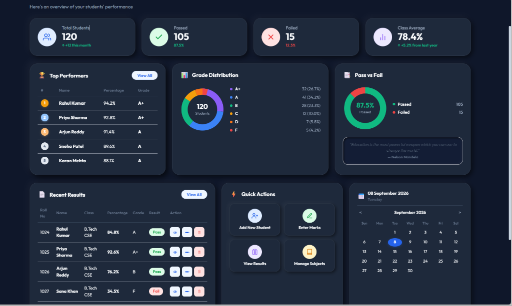
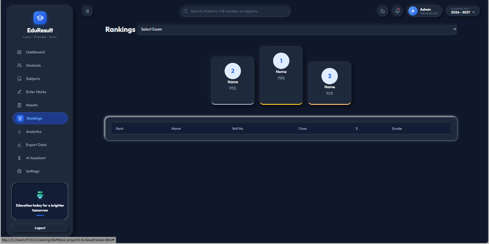
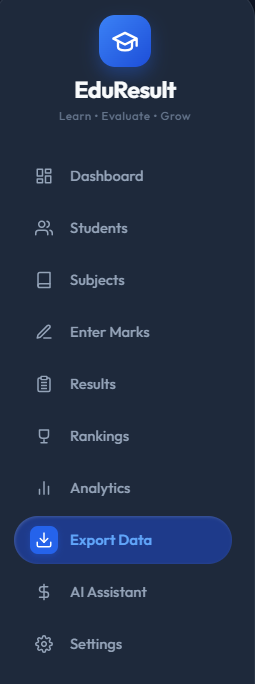

# EduResult — Student Result Management System

EduResult is a frontend-driven academic performance and result management platform for educational institutions. It delivers a modern, responsive interface for both administrators and students using pure web technologies — no frameworks, no build step, no backend.

---

## 🌟 Key Features

### Admin Portal

- **Interactive Dashboard**: Metric cards for cohort statistics, pass/fail ratios, grade distribution, and recent performance highlights.
- **Student Administration**: Add, edit, remove, search, and paginate through student profiles.
- **Subject Management**: Define CS course catalogs with credit allocations, code assignments, and passing marks.
- **Marks Entry & Engine**: Rapid marks input with instant grade assignment and pass/fail validation.
- **Academic Rankings**: Automatic dense-rank calculation supporting tied scores and percentile generation.
- **Cohort Analytics**: Visual subject proficiencies, grade distributions, and historical trends.
- **Data Export & Print Cards**: One-click CSV export and formal printable student scorecards.
- **EduBot (Rule-Based Query Assistant)**: Pattern-matched conversational assistant for instant cohort insights — **not an LLM or server-side AI**.

### Student Portal

- **Private Dashboard**: Individual cumulative percentages, grades, and recent scores.
- **My Profile & Subjects**: Personal enrollment records, contact information, and registered courses.
- **Historical Performance**: Exam-by-exam score breakdowns and proficiency tracking.
- **Goal Simulator**: Interactive target calculator determining scores needed to reach a target percentage.
- **Actionable Improvement Plan**: Diagnostic recommendations highlighting subjects needing extra focus.

---

## 🛠️ Technology Stack

| Layer | Technology |
| :--- | :--- |
| **Markup** | Semantic HTML5 with ARIA accessibility attributes |
| **Styling** | Vanilla CSS3 — Custom design system, CSS Variables, Flexbox, Grid, Media Queries |
| **Logic** | Vanilla JavaScript (ES6+) — no frameworks, no bundler |
| **Persistence** | Browser `localStorage` with automated schema recovery |
| **Testing** | Native Node.js test suite — no external test runner required |

> [!NOTE]
> This is a **fully client-side application**. There is no backend server, no database connection, and no network request at runtime. Authentication is simulated in the browser using `localStorage`. This design is intentional for a portfolio/demo project.

---

## 📐 Result Engine Rules

- **Total Marks**: Sum of obtained marks across all subjects.
- **Maximum Marks**: Sum of maximum marks across all subjects.
- **Percentage**: `(Total Marks / Maximum Marks) × 100`

### Grading Scale

| Percentage Range | Letter Grade | Status |
| :--- | :--- | :--- |
| **90.00% – 100.0%** | A+ | Pass |
| **80.00% – 89.99%** | A | Pass |
| **70.00% – 79.99%** | B | Pass |
| **60.00% – 69.99%** | C | Pass |
| **50.00% – 59.99%** | D | Pass |
| **40.00% – 49.99%** | E | Pass |
| **Below 40.00%** | F | Fail |

> A candidate **fails** if their overall percentage is below 40 % **or** if any individual subject mark falls below that subject's required passing score.

---

## 🤖 EduBot — Rule-Based Assistant

EduBot is a **pattern-matching, rule-based query assistant** implemented entirely in `js/ai.js`. It works by matching keywords in the user's question against a set of `if / regex` rules and returning pre-computed answers drawn from `localStorage` data.

**EduBot is NOT:**
- A large language model (LLM) or generative AI
- Powered by any external API or cloud service
- Capable of open-ended reasoning

**EduBot CAN:**
- Answer predefined questions about grades, ranks, and subject performance
- Explain common CS concepts from a built-in knowledge dictionary
- Enforce a strict student-privacy boundary (students cannot query other students' data)

---

## 🚀 Running the Project Locally

No build step or package installation is required.

```bash
git clone https://github.com/Shaiikarif/eduresult-student-result-management-system.git
cd eduresult-student-result-management-system
# Open index.html in any modern browser
```

Or simply download the ZIP and open `index.html` in Chrome, Edge, Firefox, or Safari.

### Demo Access

> [!CAUTION]
> These are **demo-only credentials** for a client-side application with no real backend. The password is stored in plain text in `js/data.js` as a convenience for evaluators. **Do not reuse this password anywhere.** There is no server, no real auth, and no sensitive data at risk.

| Role | Login | Value |
| :--- | :--- | :--- |
| **Admin** | Username | `admin` |
| **Admin** | Password | `EduResult@2026` |
| **Student** | Roll Number | `1001`, `1002`, `1003`, or `1004` |

---

## 🧪 Automated Testing

Run the included verification suite using Node.js (no `npm install` needed):

```bash
node tests/run_all_tests.js
```

**4 suites · 59 assertions · 0 external dependencies**

| Suite | Coverage |
| :--- | :--- |
| `unit_calculations.test.js` | Grade boundaries, percentage math, pass/fail logic |
| `rankings_analytics.test.js` | Dense-rank algorithm, tie handling, percentile calculation |
| `data_integrity.test.js` | Schema validation, duplicate detection, CSV export |
| `security_xss.test.js` | HTML escaping, XSS neutralisation, student privacy boundary |

---

## 📸 Screenshots

### Admin Dashboard


### Rankings & Analytics


### Sidebar Navigation


---

## 📁 Project Structure

```
eduresult-student-result-management-system/
├── index.html              # Single-page application entry point
├── css/
│   ├── style.css           # Base design system & CSS variables
│   ├── components.css      # Reusable UI component styles
│   └── responsive.css      # Mobile-first media queries
├── js/
│   ├── data.js             # Demo seed data & grade config constants
│   ├── storage.js          # localStorage read/write helpers
│   ├── auth.js             # Client-side session management
│   ├── students.js         # Student CRUD logic
│   ├── subjects.js         # Subject CRUD logic
│   ├── results.js          # Grade & pass/fail calculation engine
│   ├── rankings.js         # Dense-rank algorithm
│   ├── analytics.js        # Cohort statistics & aggregations
│   ├── export.js           # CSV export & print scorecard
│   ├── ai.js               # Rule-based EduBot query assistant
│   ├── ui.js               # DOM helpers, toast notifications, escapeHtml
│   └── app.js              # Application bootstrap & navigation router
├── assets/screenshots/     # README screenshot assets
├── tests/
│   ├── run_all_tests.js    # Master test runner
│   ├── unit_calculations.test.js
│   ├── rankings_analytics.test.js
│   ├── data_integrity.test.js
│   └── security_xss.test.js
├── CONTRIBUTING.md
└── LICENSE                 # MIT License
```

---

## 📄 License

This project is licensed under the **MIT License** — see the [LICENSE](LICENSE) file for details.
